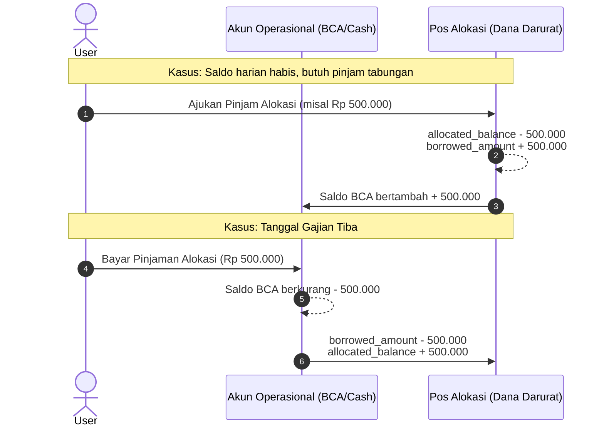

# Aturan Bisnis & Logika Perhitungan (Business Rules)

Dokumen ini memuat logika bisnis aplikasi **Jurnal Keuangan Pribadi** untuk memastikan integritas saldo dan konsistensi data saat transaksi dimanipulasi.

---

## 1. Perhitungan Saldo Akun Bank (`accounts.current_balance`)

Setiap perubahan pada tabel `transactions` harus selalu dibungkus dalam **Database Transaction (`DB::transaction`)** di Laravel.

### A. Saat Transaksi Baru Dibuat (Create)
- **Pemasukan (`income`):**
  $$\text{current\_balance}_{\text{baru}} = \text{current\_balance}_{\text{lama}} + \text{amount}$$
- **Pengeluaran (`expense`):**
  $$\text{current\_balance}_{\text{baru}} = \text{current\_balance}_{\text{lama}} - \text{amount}$$

### B. Saat Transaksi Diperbarui (Update)
Jika pengguna mengedit nominal, jenis transaksi, atau memindahkan transaksi ke akun bank lain:
1. **Revert (Kembalikan dampak transaksi lama):**
   - Jika tipe lama `income`: kurangi saldo akun lama sebesar `old_amount`.
   - Jika tipe lama `expense`: tambahkan saldo akun lama sebesar `old_amount`.
2. **Apply (Terapkan dampak transaksi baru):**
   - Jika tipe baru `income`: tambahkan saldo akun baru sebesar `new_amount`.
   - Jika tipe baru `expense`: kurangi saldo akun baru sebesar `new_amount`.

### C. Saat Transaksi Dihapus (Delete)
- Jika transaksi yang dihapus adalah `income`: kurangi `current_balance` sebesar `amount`.
- Jika transaksi yang dihapus adalah `expense`: kembalikan/tambahkan `current_balance` sebesar `amount`.

---

## 2. Mekanisme Alokasi Dana & Pinjam Tabungan (Fase 2)

Fitur ini menjawab kebutuhan: *"Saya memiliki tabungan/alokasi dana, namun terkadang saya pakai sementara jika saldo harian habis. Saat gajian, pinjaman ini harus dikembalikan."*



### Aturan Perhitungan:
1. **Pinjam Alokasi:**
   - Syarat: `borrow_amount <= allocated_balance`.
   - `allocations.allocated_balance` berkurang.
   - `allocations.borrowed_amount` bertambah.
   - Akun bank operasional yang dipilih saldo bertambah sebagai transfer masuk (internal mutation).
2. **Pelunasan Pinjaman (Saat Gajian):**
   - Syarat: Saldo akun bank operasional mencukupi nominal pelunasan.
   - `allocations.borrowed_amount` berkurang sesuai nominal yang dibayar.
   - `allocations.allocated_balance` kembali bertambah.
   - Akun bank operasional saldo berkurang.

---

## 3. Validasi Data Masukan (Laravel Form Request)

Form request wajib menerapkan validasi berikut:

```php
// TransactionRequest.php
public function rules(): array
{
    return [
        'account_id'       => ['required', 'exists:accounts,id'],
        'category_id'      => ['required', 'exists:categories,id'],
        'type'             => ['required', 'in:income,expense'],
        'amount'           => ['required', 'numeric', 'min:0.01'],
        'transaction_date' => ['required', 'date'],
        'notes'            => ['nullable', 'string', 'max:500'],
    ];
}
```

---

## 4. Pola Implementasi di Laravel (Service Layer)

Sangat disarankan membungkus logika saldo ke dalam `TransactionService` agar controller tetap ramping (*skinny controller*):

```php
namespace App\Services;

use App\Models\Transaction;
use App\Models\Account;
use Illuminate\Support\Facades\DB;

class TransactionService
{
    public function createTransaction(array $data): Transaction
    {
        return DB::transaction(function () use ($data) {
            $transaction = Transaction::create($data);
            $account = Account::findOrFail($data['account_id']);

            if ($data['type'] === 'income') {
                $account->increment('current_balance', $data['amount']);
            } else {
                $account->decrement('current_balance', $data['amount']);
            }

            return $transaction;
        });
    }
}
```

